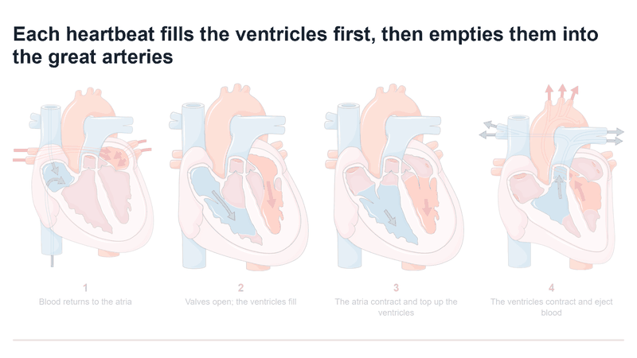
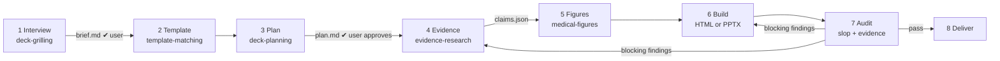
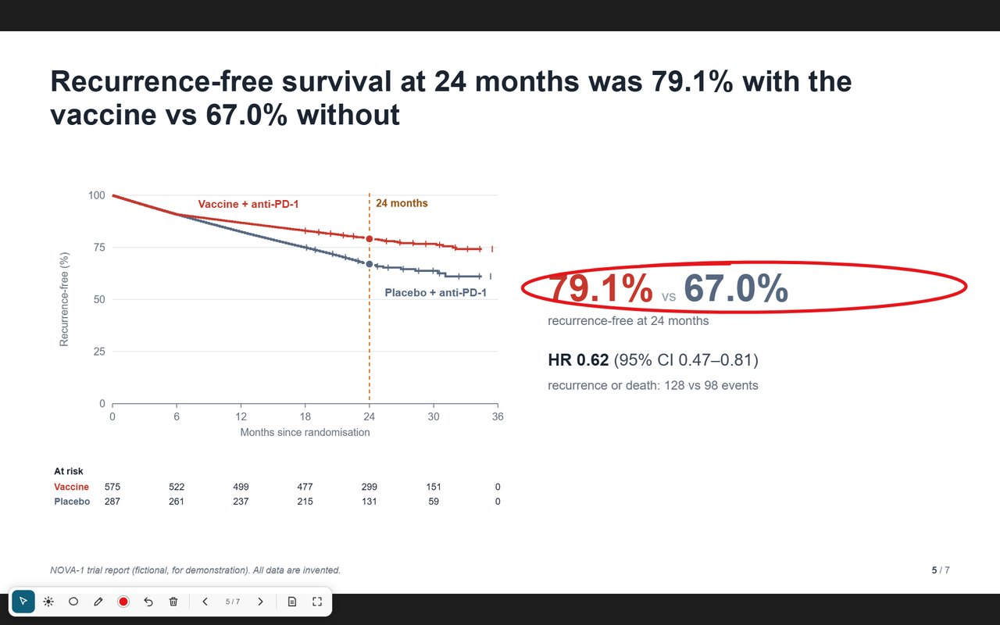
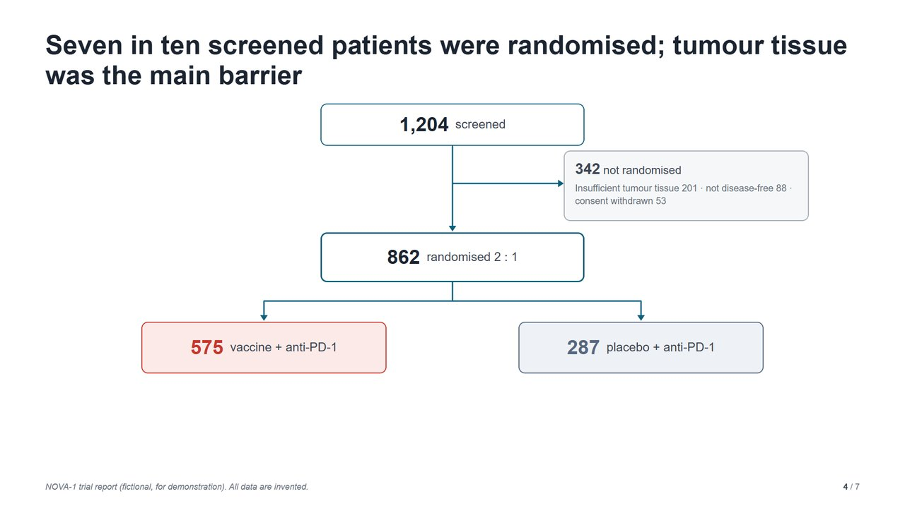
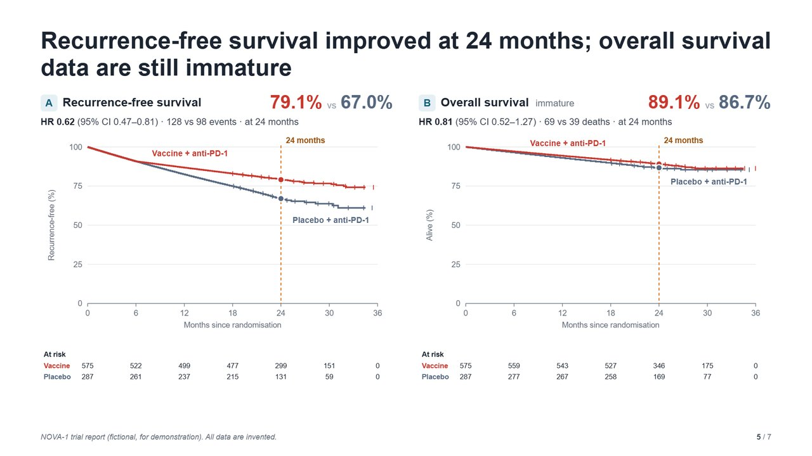
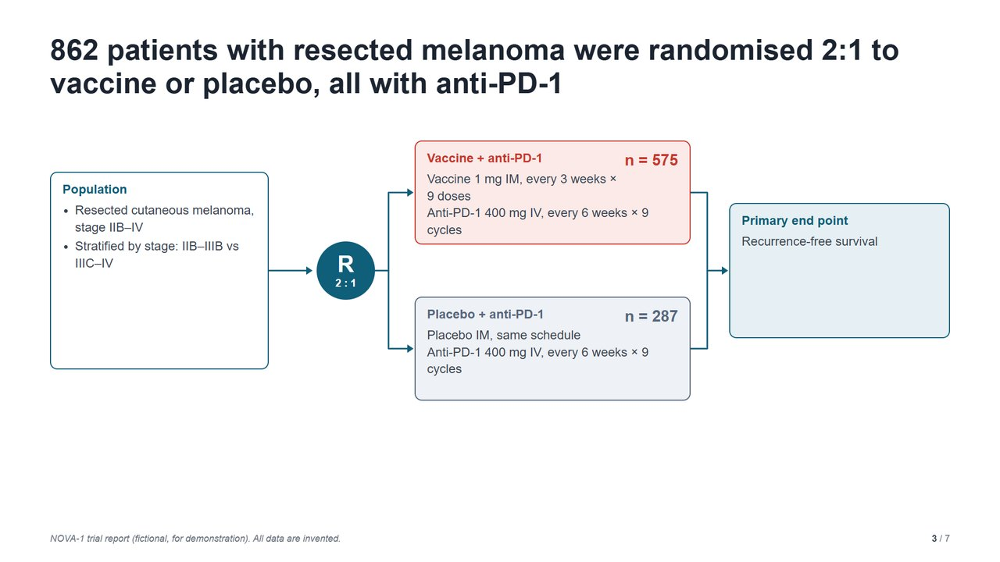
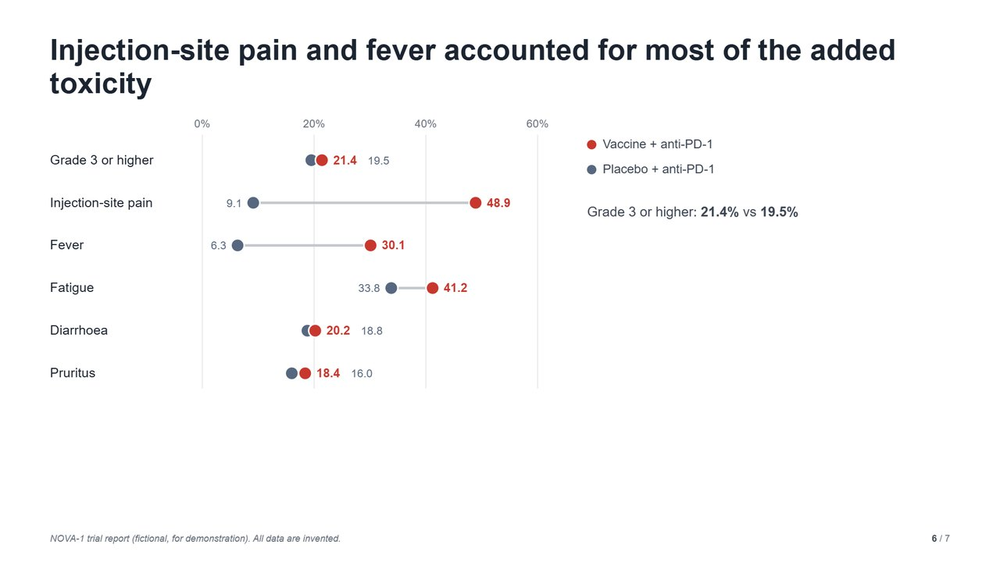
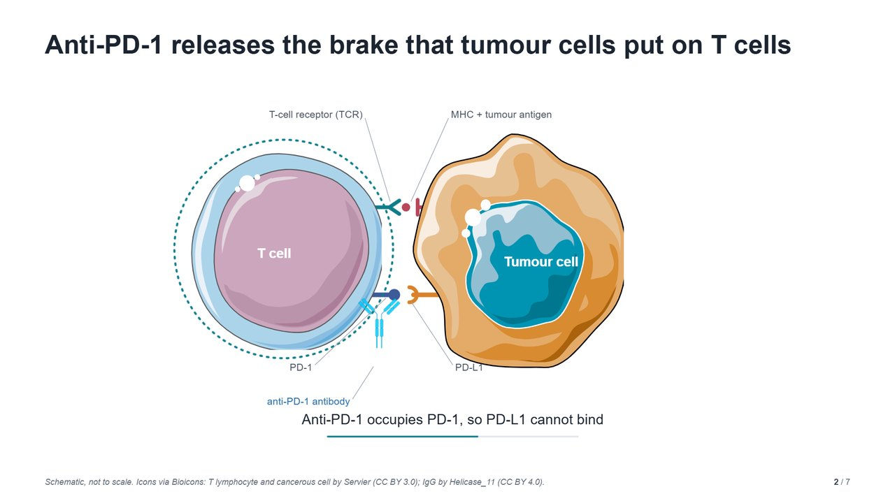
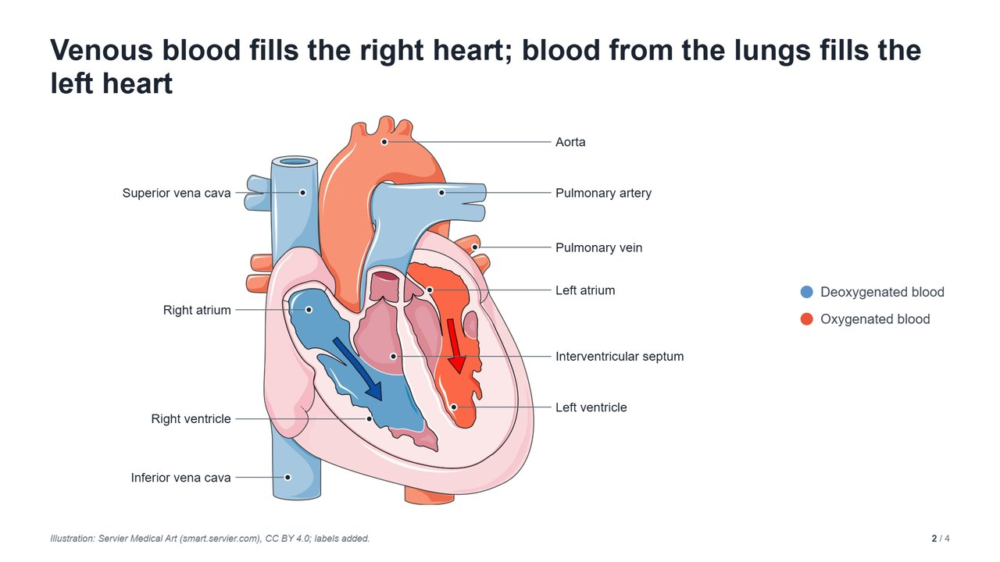
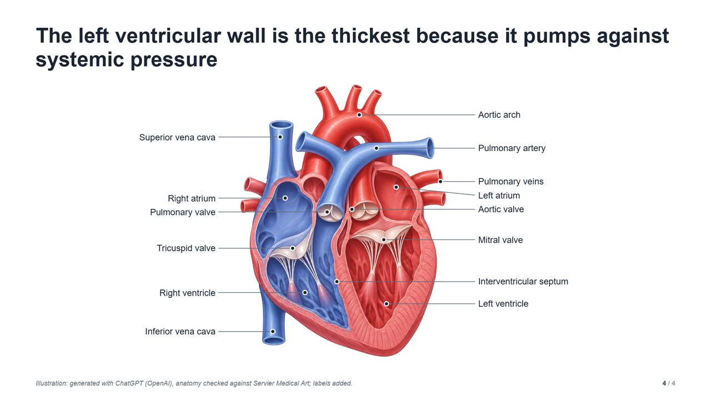

<p align="center">
  
</p>

<h1 align="center">Grand Rounds</h1>

<p align="center">
  <b>Evidence-first medical presentations, built by your coding agent.</b><br>
  A skills harness for Claude Code, Codex and Antigravity that interviews you, plans the talk,
  checks every number against its source, and catches the tells of machine-made slides.
</p>

<p align="center">
  <a href="LICENSE"></a>
  
  
  
  
</p>

<p align="center">
  
  
</p>
<p align="center"><sub>Motion inside the slide instead of a pasted video: a mechanism built from Bioicons cells and antibody (left) and a sequence of Servier Medical Art drawings played as a loop (right).</sub></p>

---

## Why this exists

Ask a general-purpose agent for "a journal club deck on trial X" and you usually get a file
within minutes. It is also usually wrong in ways that matter in front of a medical audience:

- **It decides for you.** PowerPoint or HTML, which template, who the audience is, report or
  critique. Testing showed a baseline agent listing these as "assumptions" *after*
  committing to them.
- **Numbers drift.** A hazard ratio from one endpoint lands under another. "Overall survival
  improved" appears for HR 0.77 with P = 0.33.
- **References are recalled, not retrieved.** A PMID "from memory, please verify" ends up in
  the footer.
- **The slides look machine-made**: numbered eyebrow labels, KPI-card grids, presenter cues
  printed on the slide ("▸ click for next"), notes about how a figure was made ("original
  figure, recoloured").

Grand Rounds turns slide-making into a method with gates, in the spirit of
[Superpowers](https://github.com/obra/superpowers), and starts with a structured interview
inspired by Matt Pocock's [grilling](https://github.com/mattpocock/skills) skill.

## How it works



The **orchestrator** skill (`medical-deck`) runs the stages. Stages 4–7 go to fresh
**subagents** with written role briefs: evidence researcher, figure maker, deck builder,
slop reviewer and evidence reviewer. Each works from files, not from the conversation, and
hands back a short structured report. Two gates stop for you: the **brief** and the
**plan**. Nothing is built before you approve the plan.

Every stage leaves a file in the talk folder, so a later session can resume and you can see
what was decided:

```
my-talk/
├── STATUS.md            stage tracker
├── brief.md             what you decided in the interview
├── plan.md              assertion titles, visuals, claims needed, timing
├── theme/               measured template: theme.json, scan.json, renders
├── sources/             your PDFs, guidelines, (de-identified) case notes
├── evidence/            references.json + claims.json (value, source, locator, verbatim quote)
├── figures/             SVG/PNG + manifest.json (provenance and licence)
├── build/               source, render screenshots, rendered DOM
├── out/                 the deliverable (.html or .pptx)
└── audit/               slop-report.md, evidence-report.md
```

## The skills

| Skill | Invoked by | What it is for |
|-------|------------|----------------|
| `medical-deck` | model or you | Orchestrator: stages, gates, subagent dispatch, fix loop |
| `deck-grilling` | model | Interview in rounds of numbered questions, each with a recommended answer. Facts are looked up; decisions are asked. Output format and template are always asked. |
| `deck-planning` | model | Storyline recipes (journal club, conference, lecture, guideline update, clinical case, M&M), assertion titles, visual grammar, time budget |
| `evidence-research` | model | PubMed (MCP or bundled `pubmed.py`), Europe PMC full text, ClinicalTrials.gov; a claim ledger with locators and verbatim quotes |
| `medical-figures` | model | Lift Kaplan–Meier curves and forest plots **as vectors** from the PDF and recolour them; rebuild CONSORT, PRISMA, trial schemas and timelines; **Servier Medical Art at full resolution** or **AI-generated illustrations** (ChatGPT, Gemini) with **editable labels**; looping motion graphics for mechanisms and physiology |
| `template-matching` | model | Measure a hospital or congress .pptx (colours, fonts, layouts, title boxes, backgrounds) and reproduce it |
| `html-deck-building` | model | One offline HTML file: 1920 × 1080 stage, fragments, speaker notes, smooth GPU-only motion, **laser pointer, circle and pen tools** |
| `pptx-deck-building` | model | Editable PowerPoint inside your template: native shapes for diagrams, native charts, notes |
| `slop-audit` | model | A catalog of 21 machine-made tells (S01–S21) and a linter for the mechanical ones |
| `evidence-audit` | model | Every number on every slide traced to a claim; PMIDs/DOIs verified against PubMed/Crossref; overclaim checks; patient-identifier scan |
| `/grill-deck` | you | Just the interview, to sharpen a talk idea |
| `/audit-deck` | you | Audit a deck you already have, HTML or PPTX |

<p align="center">
  
  
</p>

## What makes it different

- **Claims before slides.** Each number on a slide is a record in `claims.json` with
  its source, page/table/figure locator, a verbatim quote and a verification level (full
  text, abstract only, unverified). `check_claims.py` flags any number on a slide that no
  claim covers.
- **Original figures, not redraws.** `pdf_figures.py` cuts a Kaplan–Meier panel out of a
  journal PDF as vector line art, recolours the arms to the deck's palette and separates the
  curves into their own layer. Every step, censor tick and number at risk is preserved, and
  the curves can be animated.
- **Slop is a catalog, not a vibe.** Eyebrows (S01), presenter cues on slides (S02) and
  process narration (S03) block delivery. The linter runs on the *rendered* DOM, so it also
  catches text injected by JavaScript.
- **Your template, measured.** `scan_template.py` reports the layouts and title positions
  that the template's own slides use, so the deck sits inside the template rather than
  imitating it.
- **Libraries first, AI second, labels always editable.** Illustrations come first from
  existing medical libraries: Servier Medical Art (exported at full resolution from its
  vector PowerPoint kits) and Bioicons (`bioicons.py` searches ~2,800 icons and writes the
  credits). Only when no library has the picture is one generated, with ChatGPT or Gemini,
  whichever account you have, through your own signed-in browser and with no text in the
  pixels. Its anatomy is then checked against a reference. Labels are laid out as editable
  text with leader lines (`label_figure.py`, or native text boxes in PPTX).
- **Motion graphics instead of videos.** A mechanism or a pathway is assembled from Bioicons
  parts (cells, antibodies, receptors) and animated in CSS, so it loops inside the slide like
  a GIF. It stays sharp on any
  projector, weighs kilobytes, carries a caption per stage, and pauses on a poster frame
  for PDF export and screenshots.
- **Motion that doesn't stutter.** Only transform and opacity are animated. The render
  checker measures frame timing; the demo's curve reveal and both motion graphics run at a
  16.6–16.7 ms median frame interval (60 fps).

## Install

### Claude Code

```text
/plugin marketplace add drtranquanghung91-vn/grand-rounds
/plugin install grand-rounds@grand-rounds
```

Or for one session from a clone: `claude --plugin-dir path/to/grand-rounds`.

### Codex

The repository ships a Codex plugin manifest (`.codex-plugin/plugin.json`) and a marketplace
file (`.agents/plugins/marketplace.json`). Each skill also has an `agents/openai.yaml`, and
`/grill-deck` and `/audit-deck` are marked as explicit-only. If your Codex version has no
plugin installer, copy or link the skills:

```bash
git clone https://github.com/drtranquanghung91-vn/grand-rounds
cp -r grand-rounds/skills/* ~/.agents/skills/
```

For subagents, enable `[features] multi_agent = true` in `~/.codex/config.toml`.

### Antigravity

```bash
agy plugin install https://github.com/drtranquanghung91-vn/grand-rounds
```

Antigravity has no Skill tool, so the skills tell the model to read a skill's `SKILL.md`
when it applies. Subagents use `invoke_subagent`.

> Status of v0.1.0: the Claude Code marketplace manifest passes `claude plugin validate`;
> the skills were exercised in behaviour scenarios and every script by unit tests and real
> runs. The Codex and Antigravity manifests follow the layout Superpowers uses for those
> harnesses but have not yet been installed end-to-end. Reports are welcome.

### Tools the scripts use

| Need | Install |
|------|---------|
| Everything except the items below | Python 3.10+ (standard library only) |
| Lifting figures from PDFs | `pip install pymupdf` |
| Labels on illustrations | `pip install pillow` |
| Bioicons search and download | nothing extra (standard library; uses the GitHub API) |
| AI-generated illustrations | a browser tool (Playwright MCP, Claude in Chrome, Antigravity browser) signed in to your ChatGPT or Gemini account |
| PPTX build and checks | `pip install python-pptx` |
| HTML render check, SVG → PNG | `pip install playwright`, then `python -m playwright install chromium`, or use an installed Edge or Chrome |
| PPTX renders for visual QA | PowerPoint (Windows) or LibreOffice |
| PubMed through MCP (optional) | any PubMed MCP server; otherwise the bundled `pubmed.py` is used |

## Try it

```text
Make a 10-minute journal club deck on the attached paper.
I need to present our hospital's case of drug-induced liver injury at grand rounds, 15 minutes, PowerPoint, template attached.
Summarise what changed in the 2025 heart failure guideline for our residents, 20 minutes.
/audit-deck slides/conference-talk.pptx
```

The agent starts with a single round of numbered questions. Reply "yes" to accept every
recommendation, or answer the ones you care about.

## Examples

[`examples/fictional-trial/`](examples/fictional-trial) is a complete journal-club run on a
**fictional** trial. Every stage's file is present: brief, plan, claims, figures manifest,
built deck and both audit reports. Open `out/nova1-journal-club.html` in a browser and use →
to step through it, `L` for the laser, `C` to circle and `N` for notes.

<p align="center">
  
  
</p>
<p align="center">
  
  
</p>

[`examples/heart-anatomy/`](examples/heart-anatomy) shows the illustration routes on a
teaching topic:

- a Servier Medical Art drawing with labels added as text;
- the four Servier drawings of the cardiac cycle played as a loop;
- an illustration generated with ChatGPT and checked against Servier. The check found that
  the vessels on the left are drawn into the right atrium; that error is left unlabelled
  and recorded in the manifest.

<p align="center">
  
  
</p>

## Repository layout

```
skills/                 one folder per skill: SKILL.md, references, scripts/, agents/openai.yaml
  medical-deck/roles/   subagent briefs for stages 4–7
examples/fictional-trial/   an end-to-end journal-club run with every intermediate file
examples/heart-anatomy/     teaching slides: Servier and AI illustrations, labels, a cycle loop
tests/unit/             tests for every script (python -m unittest discover -s tests/unit)
tests/scenarios/        RED/GREEN behaviour scenarios for the skills
docs/                   architecture and per-harness notes
.claude-plugin/ .codex-plugin/ .agents/ .antigravity-plugin/   harness manifests
```

## Testing

```bash
python -m unittest discover -s tests/unit -v
```

The skills were written test-first, as Superpowers prescribes. Each behaviour was first run
on an agent without the skills, and the failures were recorded in
[`tests/scenarios/BASELINE.md`](tests/scenarios/BASELINE.md). The skills were then written
to fix those failures, and the scenarios re-run with them loaded
([`tests/scenarios/README.md`](tests/scenarios/README.md)).

## Acknowledgements

Grand Rounds borrows ideas, not code, from these projects. Thank you to their authors.

- [obra/superpowers](https://github.com/obra/superpowers): skills as methodology, TDD for
  skills, multi-harness packaging
- [mattpocock/skills](https://github.com/mattpocock/skills): the `grilling` design-tree
  interview, user- vs model-invoked skills
- [Gabberflast/academic-pptx-skill](https://github.com/Gabberflast/academic-pptx-skill):
  action titles and academic storytelling
- [kgraph57/medical-slide-templates](https://github.com/kgraph57/medical-slide-templates):
  medical slide patterns and safety gates
- [kau10082/slide-verify](https://github.com/kau10082/slide-verify): "a real paper does not
  make the number right", verification ledgers
- [mpuig/agent-slides](https://github.com/mpuig/agent-slides),
  [Rich627/slides-skill](https://github.com/Rich627/slides-skill),
  [vedraut/slidesage](https://github.com/vedraut/slidesage),
  [openai/skills](https://github.com/openai/skills): composable slide skills, spec-driven
  rendering, render-and-check loops
- [HKUDS/Paper2Slides](https://github.com/HKUDS/Paper2Slides) and
  [OpenDCAI/Paper2Any](https://github.com/OpenDCAI/Paper2Any): paper-to-slides pipelines
- Illustration libraries the figures skill points to:
  [Servier Medical Art](https://smart.servier.com) (CC BY 4.0) and
  [Bioicons](https://bioicons.com)

## Disclaimer

Grand Rounds helps prepare presentations. It does not give medical advice. The presenter is
responsible for the content, for checking every claim against its source, for patient
consent and de-identification, and for the right to reuse published figures.

## Licence

[MIT](LICENSE) © 2026 Trần Quang Hưng. The licence covers this repository's code and text.
The Servier Medical Art and Bioicons images in the examples keep their own CC BY licences (see [NOTICE](NOTICE.md)).
The MIT licence does not extend to third-party figures or illustrations you add to your own
decks.
